# `NETWORKWALKS // WEEK 03`

# ⚡ PDF PASSWORD CRACKING

### `OFFENSIVE SECURITY | PASSWORD RECOVERY | PRACTICAL LAB`

**Exploring PDF password recovery with John the Ripper, Johnny and NetworkWalks tools.**

---

## `01 // MISSION BRIEF`

This repository documents my **Week 03 practical assignment** from the NetworkWalks Cybersecurity Training Program.

The lab focused on understanding PDF password protection and performing authorized password-recovery tests using two approaches:

- **Local testing:** John the Ripper (JTR), Johnny and `pdf2john` on Kali Linux.
- **Online testing:** NetworkWalks Hash Calculator and Password Cracker.

Three password-protected PDF files were used during the exercises.

## `02 // OBJECTIVES`

- Understand PDF password-protection mechanisms.
- Extract PDF password-verification data.
- Prepare hash files for local testing.
- Explore John the Ripper and Johnny.
- Use NetworkWalks online password-recovery tools.
- Test recovery results against protected PDF documents.
- Capture and document practical evidence.

## `03 // TOOLKIT`

| Tool | Purpose |
|---|---|
| Kali Linux | Testing environment |
| John the Ripper | Password-recovery testing |
| Johnny | Graphical interface for John the Ripper |
| pdf2john | Extract PDF password data |
| NetworkWalks Hash Calculator | Online hash extraction |
| NetworkWalks Password Cracker | Online recovery testing |
| Terminal | Command execution and file handling |

## `04 // OPERATIONAL WORKFLOW`

### PHASE 01 — LOCAL HASH EXTRACTION

Used `pdf2john` to extract the password-related data from the protected PDF documents.

The extracted output was saved into individual hash files for further testing.

### PHASE 02 — JOHN THE RIPPER & JOHNNY

Used John the Ripper and its graphical interface, Johnny, to perform password-recovery tests.

Workflow:

1. Prepare the extracted hash files.
2. Load the hash data into the cracking workflow.
3. Execute password-recovery tests.
4. Review the results.
5. Verify the recovered password by opening the corresponding PDF.

### PHASE 03 — NETWORKWALKS ONLINE TOOLS

Explored the online tools provided by NetworkWalks.

Workflow:

1. Open the Hash Calculator.
2. Upload the protected PDF.
3. Extract the PDF hash.
4. Submit the extracted hash to the Password Cracker.
5. Review the recovery result.
6. Verify the password by opening the PDF.

### PHASE 04 — DOCUMENT VERIFICATION

Tested the recovered passwords against the corresponding protected documents to confirm successful access.

## `05 // PRACTICAL TARGETS`

| Target | Local JTR / Johnny | NetworkWalks online evidence |
|---|---|---|
| PDF 01 | Tested and verified | Tested and verified |
| PDF 02 | Tested and verified | Not included in uploaded evidence |
| PDF 03 | Tested and verified | Not included in uploaded evidence |

*The online-tool screenshots currently uploaded document the PDF 01 workflow. The local JTR/Johnny screenshots document all three PDFs.*

## `06 // EVIDENCE ARCHIVE`

All 16 practical screenshots are available in the repository root.

### LOCAL TESTING — JOHN THE RIPPER & JOHNNY

**01 — Tool Details**

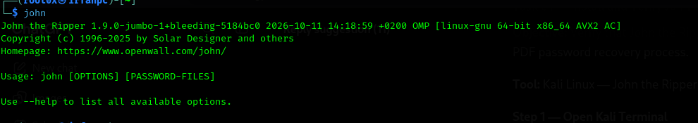

**02 — PDF Hash Extraction**

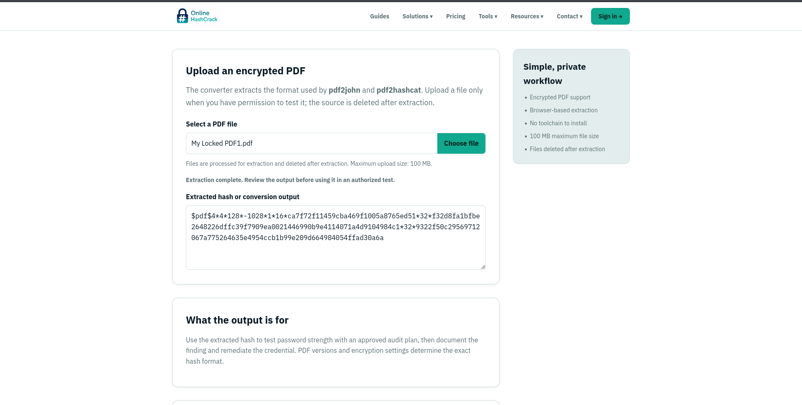

**03 — Hash File Creation**

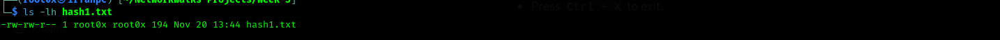

**04 — Johnny Launch**

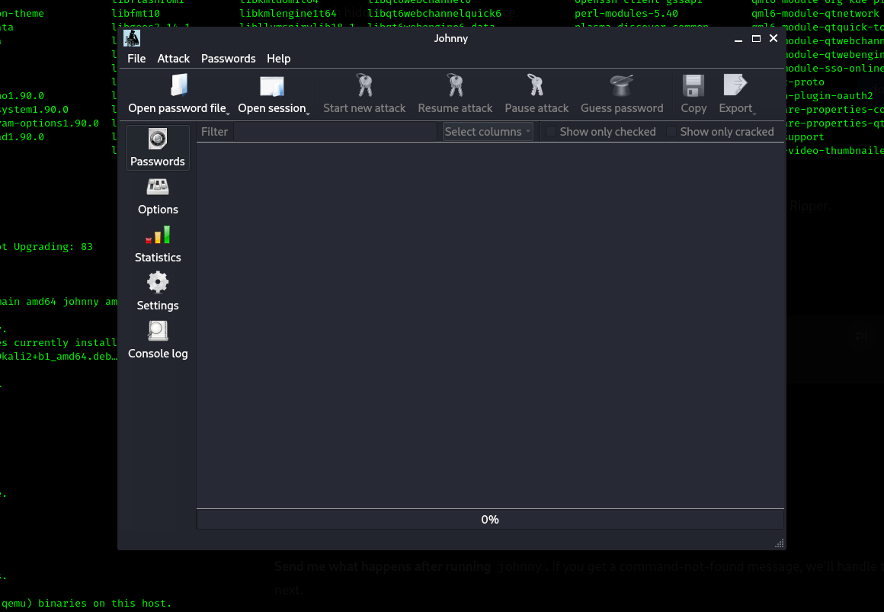

**05 — Password Recovery Result**

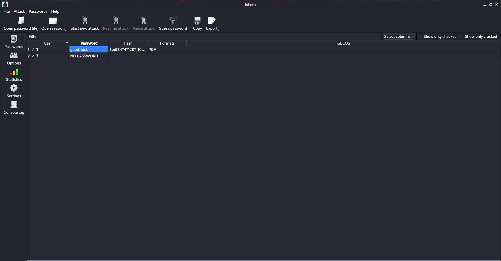

**06 — PDF 01 Verification**

**07 — PDF 02 Hash Extraction**

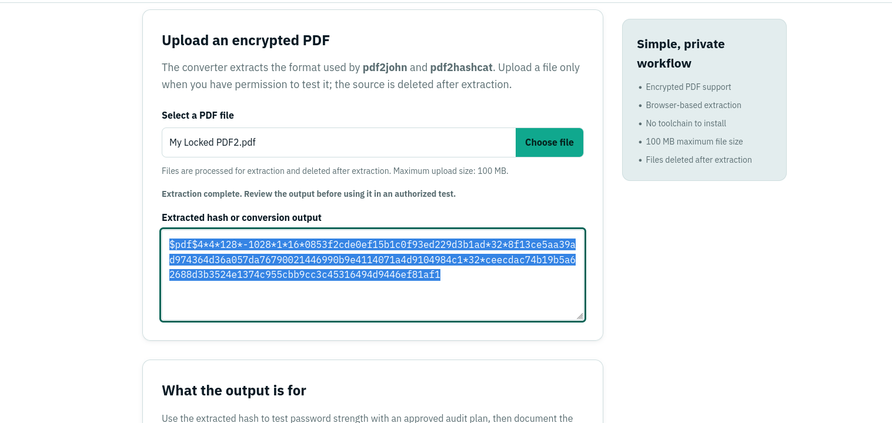

**08 — PDF 02 Recovery Workflow**

**09 — PDF 02 Verification**

**10 — PDF 03 Hash Extraction**

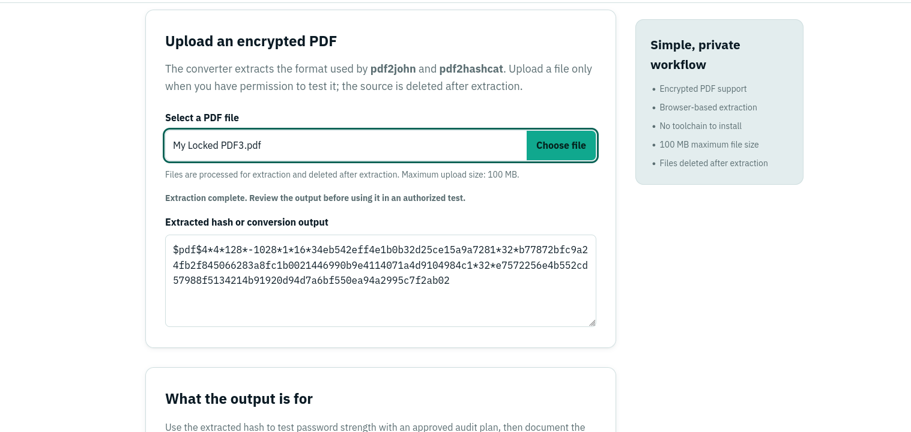

**11 — PDF 03 Recovery Workflow**

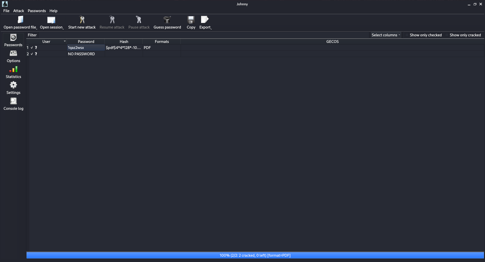

**12 — PDF 03 Verification**

### ONLINE TESTING — NETWORKWALKS TOOLS

**13 — NetworkWalks Hash Calculator**

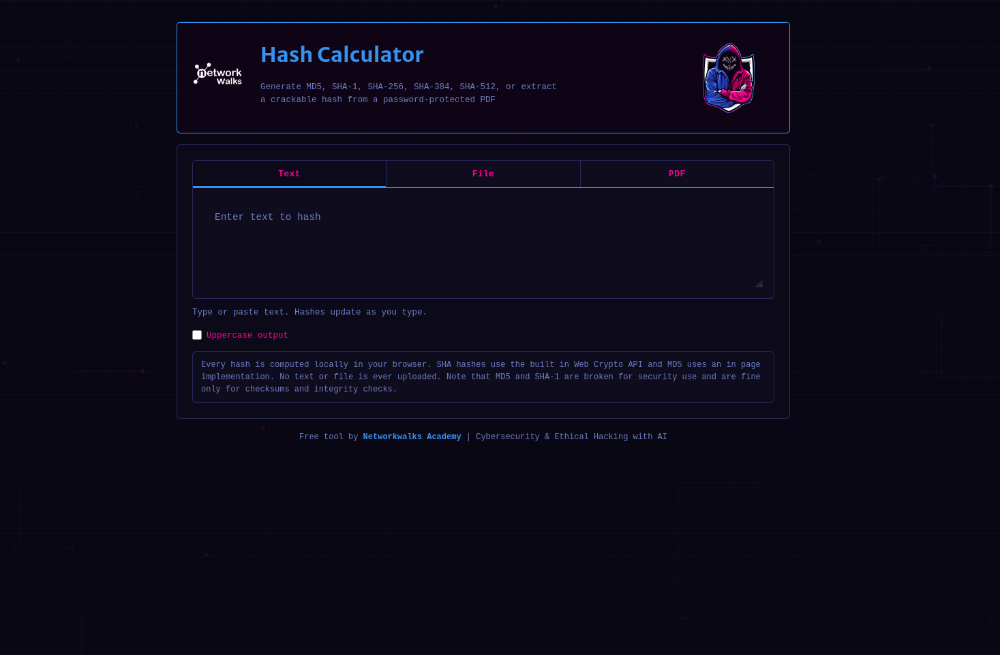

**14 — PDF Hash Extraction**

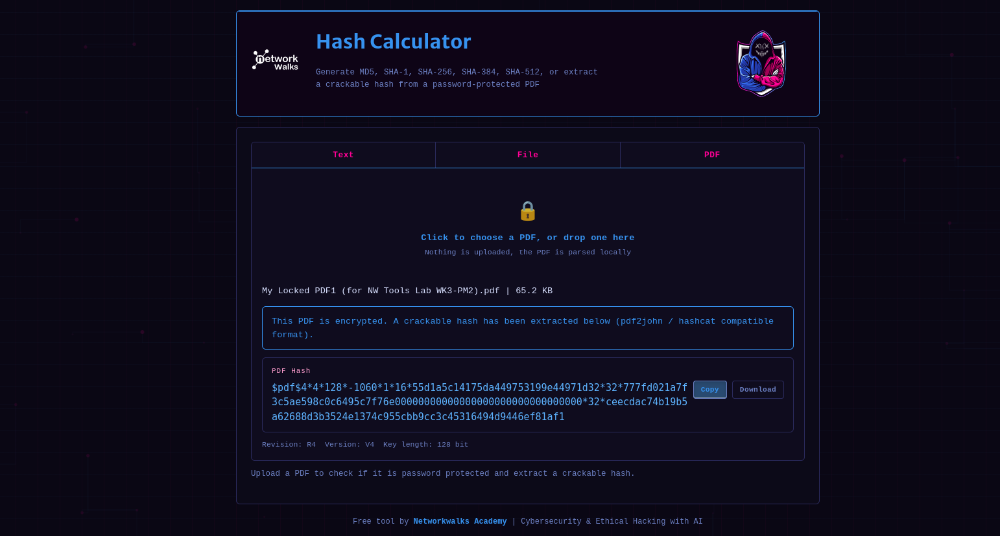

**15 — NetworkWalks Password Cracker**

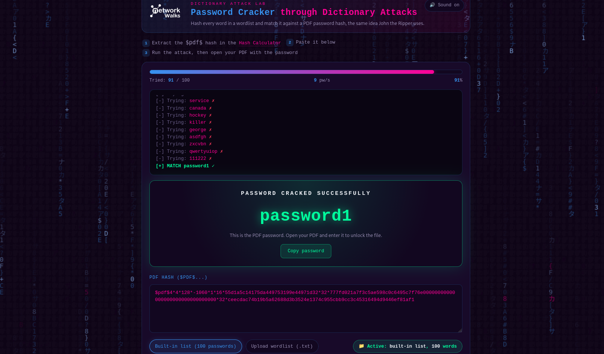

**16 — PDF 01 Verification**

## `07 // KEY TAKEAWAYS`

This practical assignment helped me gain hands-on experience with:

- PDF password-data extraction.
- Hash-file preparation.
- John the Ripper command-line workflow.
- Johnny graphical interface.
- Online password-recovery tools.
- Password-recovery result verification.
- Understanding the importance of strong passwords.

## `08 // ETHICAL USE`

This project was completed for educational purposes using the training materials provided for the NetworkWalks assignment.

All password-recovery activities should be performed only on files owned by the tester or with explicit authorization.

**Recovered passwords and raw hash values are intentionally excluded from this public repository.**

## `09 // REFERENCES`

- [NetworkWalks Password Cracking Lab](https://networkwalks.com/project-task-lab-password-cracking-with-networkwalks-tools/)
- [NetworkWalks Hash Calculator](https://networkwalks.com/hash-calculator/)
- [NetworkWalks Password Cracker](https://networkwalks.com/password-cracker/)
- [John the Ripper](https://www.openwall.com/john/)
- [Kali Linux](https://www.kali.org/)

---

### `> WEEK 03 // MISSION COMPLETE`

**NETWORKWALKS CYBERSECURITY TRAINING**

`LEARN // TEST // ANALYZE // SECURE`

*Building practical cybersecurity skills, one lab at a time.*

